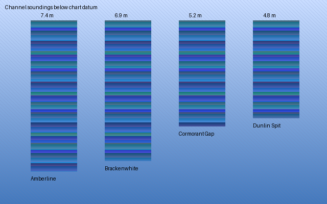

# Quillmere Harbour Survey

The Quillmere harbour authority commissioned this survey after the storm season of the
previous winter. Surveyors walked every pier, counted every bollard and logged the depth of
the channel at low tide. Their notes describe a working harbour with old timber, new cranes
and a lighthouse that still turns by clockwork.

## Northern Breakwater

The northern breakwater shelters the inner basin from the prevailing westerly swell. Its
granite blocks were quarried at Tolverran and set without mortar, which lets the sea drain
through the joints instead of lifting the cap stones. Divers found three cracked blocks near
the elbow and one missing block close to the beacon. The survey recommends replacing the
missing block before the autumn gales and monitoring the cracked ones each spring.

Fishing crews moor along the inside face, where the water stays calm even in a gale. The
oldest ring bolts carry the stamp of the Penhallow foundry and date from the first harbour
act. A tidal gauge fixed to the third ladder records the water level every ten minutes.

{width=0.4cm}

```{=latex}
\newpage
```

## Channel Soundings

The table records the soundings taken along the approach channel. Depths are in metres
below chart datum, measured at the lowest spring tide of the survey month.

| Marker        | Depth (m) | Seabed        |
|---------------|-----------|---------------|
| Amberline     | 7.4       | coarse sand   |
| Brackenwhite  | 6.9       | shingle       |
| Cormorant Gap | 5.2       | soft mud      |
| Dunlin Spit   | 4.8       | shell grit    |

{width=9cm}

The shallowest reading lies off Dunlin Spit, where silt from the Merrow estuary settles after
heavy rain. The pilots asked for a dredging campaign to restore the charted depth of six
metres before the larger grain ships begin calling at the harbour.

The surveyors also logged the moorings of the visiting yacht fleet. Most swing moorings use
concrete sinkers, and the chain on several of them had worn thin where it rubs the seabed.
The harbour master will replace those chains during the winter lay-up.

```{=latex}
\newpage
```

## Lighthouse and Signals

The Saltreach lighthouse stands on the southern headland. Its lens was ground in Birmingham
and floats on a bath of mercury, so a small clockwork motor can turn the whole optic. The
keeper winds the weights every four hours through the night. The light shows two white
flashes every fifteen seconds and can be seen from twenty nautical miles in clear weather.

A foghorn below the lantern sounds one long blast every thirty seconds when visibility drops
under two miles. The survey found the compressor in good order but the air receiver needs a
pressure test before the next insurance inspection.

## Recommendations

Replace the missing breakwater block, dredge the channel off Dunlin Spit, renew the worn
mooring chains and test the foghorn air receiver. With these repairs the Quillmere harbour
can serve the fishing fleet and the grain trade for another generation.
